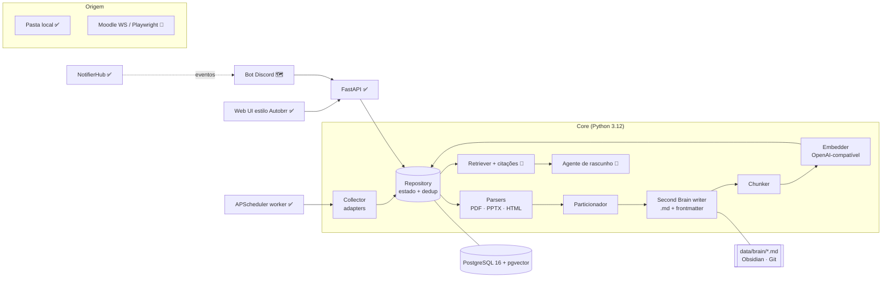

# Arquitetura — MoodleTracker

> Status por camada: ✅ implementado nesta fase · 🧩 interface/contrato pronto · 🗺️ planejado

## 1. Visão geral



Princípios:

- **Core sem framework**: domínio (`domain/`), parsers, writer e chunker são funções/classes puras, testáveis sem banco nem HTTP.
- **Portas e adapters**: `Collector`, `Parser`, `Embedder`, `Notifier`, `PipelineTrigger`, `Retriever` e `DraftAgent` são `Protocol`s. Trocar de origem ou de provedor não mexe no pipeline.
- **Banco como fonte de verdade do estado**; o `.md` é a fonte de verdade do **conteúdo** (legível, versionável e citável).
- **Idempotência**: reexecutar o pipeline não duplica nada; um conteúdo só é reprocessado quando o hash muda.
- **Composition root único** (`container.py`): CLI, worker e API montam as mesmas dependências a partir das `Settings`.

## 2. Estrutura de diretórios

```
src/moodletracker/
  config.py              Pydantic Settings (prefixo MT_), validação cruzada
  logs.py                structlog (console | json)
  errors.py              hierarquia de erros por estágio
  container.py           composition root
  domain/models.py       RawItem, Section, ParsedDocument, Partition, enums de estágio/status
  collectors/
    base.py              Protocol Collector + build_collector + sha256 em streaming   ✅
    local_folder.py      inbox/<Disciplina>/<Aula>/arquivo                           ✅
    moodle/protocol.py   MoodleClient, MoodleCourse, MoodleResource                  🧩
  parsers/               pdf.py · pptx.py · html.py · partition.py · base.py (registry) ✅
  brain/writer.py        .md + frontmatter YAML, _index.md, wikilinks, escrita atômica ✅
  pipeline/
    service.py           orquestração e registro de estágios                         ✅
    chunking.py          chunks por título com overlap e offset                      ✅
  rag/
    embeddings.py        provedor OpenAI-compatível (OpenAI/Ollama/vLLM…)            ✅
    protocols.py         Retriever, ChatModel, DraftAgent, Citation                  🧩
  db/                    tables.py (ORM) · schema.py (init/check/DDL) · repository.py · records.py ✅
  scheduler/worker.py    ScheduledWorker (APScheduler) · InlineTrigger              ✅
  api/                   app.py (FastAPI) · schemas.py                               ✅
  web/static/            UI (HTML/CSS/JS sem build)                                  ✅
  integrations/
    notifier.py          NotifierHub + LoggingNotifier                               ✅
    discord/             desenho do bot                                              🗺️
  devtools/samples.py    gerador de PDF/PPTX/HTML de exemplo
sql/                     00-extensions.sql (docker init) · schema.sql (DDL gerado)
tests/                   unitários + integração com PostgreSQL real
```

## 3. Pipeline e estágios

| # | Estágio (`items.stage`) | O que acontece | Artefato |
|---|---|---|---|
| 0 | `discovered` | Collector encontra o arquivo, calcula SHA-256 e o repositório decide: novo, alterado, inalterado ou duplicado | linha em `items` |
| 1 | `extracted` | Parser gera `ParsedDocument` (seções em Markdown com localizador) | — |
| 2 | `markdown` | Particionador agrupa por aula/tópico e o writer grava `.md` com frontmatter | `documents`, arquivos `.md` |
| 3 | `chunked` | Chunker divide o corpo de cada `.md` por título, com overlap | `chunks` (sem vetor) |
| 4 | `embedded` | Embedder gera os vetores (pulado se `MT_EMBEDDING_PROVIDER=none`) | `chunks.embedding` |
| 5 | `drafted` 🗺️ | Agente gera resumo/rascunho com citações | `items.summary` |

`items.stage` guarda o **último estágio concluído**, e `items.status` guarda `queued | processing | completed | failed | duplicate`. Em caso de falha, o evento `item_failed` registra o **estágio que estava em execução**, e a UI pinta esse passo de vermelho.

Regras de estado (`PipelineRepository.register_discovered`):

- **Mesmo `(source_adapter, source_id)` e mesmo hash**: inalterado. Se estiver `failed` e `attempts < 3`, volta para a fila (*retry* automático).
- **Mesmo source com hash novo**: alterado. Volta a `discovered/queued`, zera tentativas e **reinicia a revisão**. Partições órfãs (por exemplo, quando o título mudou) são apagadas do disco.
- **Hash igual ao de outro item canônico**: `duplicate`, com `duplicate_of_id` apontando para o original e sem reprocessamento. Garantido no banco por um índice único parcial (`content_hash WHERE duplicate_of_id IS NULL`).
- **Concorrência**: `pg_try_advisory_lock` impede duas execuções simultâneas (scheduler, botão da UI ou outro processo), e a execução concorrente fica registrada como `skipped`. O `claim_queued` usa `FOR UPDATE SKIP LOCKED`, pronto para vários workers.
- **Recuperação**: itens presos em `processing` (worker morto) voltam para a fila no início da próxima execução.

## 4. Extração e particionamento

| Formato | Estrutura usada | Localizador (citação) | Partição nova quando |
|---|---|---|---|
| PDF (PyMuPDF) | 1º sumário embutido, 2º títulos por tamanho de fonte (≥1,25× o corpo), 3º página | `p. 3–5` | entrada nível 1 do sumário ou título de nível mais alto |
| PPTX (python-pptx) | 1 seção por slide; bullets com nível, tabelas viram tabelas MD, notas viram citação | `slide 7` | layout "Section Header"/"Seção" ou slide só com título |
| HTML (BeautifulSoup) | região principal do Moodle (`#region-main`, `[role=main]`), sem nav/script | `§ Título` | `h1`/`h2` de nível mais alto |

- Cabeçalhos e rodapés repetidos são removidos **apenas nas margens** (8% superior/inferior) de ≥60% das páginas, para nunca apagar corpo de texto.
- Partições respeitam `MT_PARTITION_MAX_CHARS`; seções gigantes são quebradas por parágrafo ("(cont. 2)").
- PDF digitalizado (sem texto) gera um `ParseError` explícito. Há um gancho para OCR (ex.: `ocrmypdf`) como parser alternativo registrado no `ParserRegistry`.

## 5. Second Brain (`data/brain`)

```
<Disciplina>/<Aula ou Módulo>/<Título do material>/
  _index.md                  visão geral + [[links]] para as partes
  01 - Introdução.md
  02 - Formas normais.md
```

Frontmatter de cada parte (YAML):

```yaml
course: Banco de Dados
module: Aula 03 - Normalização
title: 2. Primeira e segunda formas normais
source_file: Banco de Dados/Aula 03 - Normalização/normalizacao.pdf
item_type: pdf
collected_at: '2026-11-28T20:37:42+00:00'
content_hash: 7330f8…        # SHA-256 do arquivo de origem
document_title: Normalização de Dados
part: 2
parts: 3
locator: p. 2
tags: [moodletracker, banco-de-dados, pdf]
```

- A escrita é atômica (arquivo temporário + `os.replace`) e o caminho é validado contra *path traversal*.
- Os nomes de pasta são legíveis (Obsidian). Colisões de título no mesmo módulo são desambiguadas de forma determinística (`(pdf-1a2b3c)`).
- Para versionar, aponte `MT_BRAIN_DIR` para um repositório Git próprio. Um job futuro pode fazer `git commit` a cada execução.

## 6. Banco de dados

Fonte da verdade: `db/tables.py`. Referência: `sql/schema.sql`, gerado por `moodletracker db schema` e verificado por teste.

| Tabela | Papel |
|---|---|
| `courses` | disciplinas (nome + slug únicos) |
| `items` | material/atividade: origem, hash, `stage`, `status`, erro, tentativas, duplicata, revisão (`review_status`, nota, data), `summary` (fase de rascunho) e `metadata` JSONB |
| `documents` | partições `.md` (caminho relativo, localizador, hash, tamanho) |
| `chunks` | trecho + `heading_path` + `char_start` (offset no `.md`) + `embedding vector(N)` + modelo; índice **HNSW cosseno** |
| `item_events` | feed: tipo, estágio, nível e dados JSONB; alimenta a UI e as notificações |
| `pipeline_runs` | execuções: gatilho, status, estatísticas e erro |
| `schema_info` | `embedding_dim` e `schema_version`: o startup recusa uma dimensão divergente |

Os enums são nativos do PostgreSQL (`pipeline_stage`, `item_status`, `review_status` etc.). Migrações versionadas com **Alembic** entram quando o schema estabilizar (fase 2); até lá, `db init` é idempotente.

## 7. RAG e agente de rascunho (fase 3) 🧩

Contratos em `rag/protocols.py`. A recuperação já existe em `PipelineRepository.search_chunks` (distância cosseno, filtro por disciplina) e na CLI `moodletracker search`.

Desenho anti-alucinação:

1. **Recuperação híbrida**: pgvector (semântica) somada ao `tsvector` em português (lexical), com fusão por *Reciprocal Rank Fusion*. Abaixo de `min_relevance`, o resultado é "não encontrei nos materiais".
2. **Contexto rotulado**: cada trecho entra no prompt como `[n] <caminho.md> · <localizador>`, e o system prompt exige que **toda afirmação** termine com `[n]`.
3. **Verificação pós-geração**: as citações `[n]` são validadas (o número existe? a citação literal aparece no trecho?). Afirmações sem suporte vão para `DraftResult.unsupported_claims`, e a UI as destaca para revisão humana.
4. **Saída**: resumo em `.md` (`<material>/_resumo.md`) com links `[[parte#seção]]`, `items.summary` e o estágio `drafted`. A revisão (aprovar/ajustar) já existe na UI.
5. **Cliente LLM**: `/v1/chat/completions` configurável (`MT_LLM_*`), com temperatura baixa e respostas estruturadas (JSON Schema) quando o provedor suportar.

## 8. Agendamento

- `ScheduledWorker`: APScheduler com `coalesce`, `max_instances=1` e `misfire_grace_time`, que roda já na subida e depois a cada `MT_SCHEDULE_INTERVAL_SECONDS`.
- **Modos**: embutido na API (`moodletracker serve`) **ou** processos separados (`serve --no-scheduler` + `moodletracker worker`). O advisory lock torna seguro rodar vários.
- `POST /api/pipeline/run` usa a porta `PipelineTrigger` e não depende de qual modo está ativo.
- O desligamento é gracioso: aguarda a execução em andamento.

## 9. API HTTP

| Método | Rota | Uso |
|---|---|---|
| GET | `/api/health` | banco, pgvector, dimensão, scheduler, coletor, embeddings |
| GET | `/api/stats` | contagens por status/estágio/revisão + últimas execuções |
| GET | `/api/courses` | disciplinas com contagem |
| GET | `/api/items` | filtros `course_id, stage, status, review_status, item_type, q`, paginação |
| GET | `/api/items/{id}` | item + partições + linha do tempo + contagem de chunks |
| PATCH | `/api/items/{id}/review` | `{status: approved\|needs_changes\|unreviewed, note}` |
| POST | `/api/items/{id}/reprocess` | recoloca na fila e dispara |
| GET | `/api/documents/{id}` | frontmatter + Markdown da partição |
| GET | `/api/events` | feed (`limit`, `before_id`, `course_id`) |
| POST | `/api/pipeline/run` | execução manual (202) |

OpenAPI em `/docs`. A mesma API atende a UI e, no futuro, o bot do Discord.

## 10. Web UI

HTML/CSS/JS sem etapa de build, servido em `/`, com visual inspirado no Autobrr:

- topo com status (banco/scheduler/próxima execução) e "Executar agora";
- cards de métricas e funil por estágio (clicável, abre os itens filtrados);
- tabela densa com stepper de 6 passos, badges de status e revisão, agrupamento por matéria e filtros (matéria, estágio, status, revisão, tipo, busca) persistidos na URL;
- feed de eventos ao vivo (polling de 5 s, pausado com a aba oculta);
- painel lateral com pipeline detalhado, erro, metadados, revisão, partições `.md` renderizadas (com frontmatter) e linha do tempo.

O Markdown é renderizado com escape prévio de todo o conteúdo (sem XSS).

## 11. Conector Moodle (fase 2) 🧩

`MoodleCollector` implementará `Collector` usando um `MoodleClient`:

- **Web Services REST** (preferido): `core_webservice_get_site_info`, `core_enrol_get_users_courses`, `core_course_get_contents` (seções = aulas; módulos = recursos), `mod_assign_get_assignments` (prazos) e download via `pluginfile.php?token=`.
- **Playwright** (fallback): login com sessão persistida (`storage_state`), raspagem de `course/view.php` e downloads.
- **Cache local** `data/cache/<course_id>/<module_id>/<arquivo>`: `RawItem.local_path` aponta para ele, `source_id = "moodle:<module_id>:<filename>"`, e `timemodified` + hash evitam rebaixar arquivos.
- Atividades sem arquivo (página, tarefa, URL) viram HTML sintetizado pelo `HtmlParser` com prazo e descrição.
- Haverá limite de taxa e *backoff*. O token fica em `SecretStr` e nunca é logado.

## 12. Discord (fase 4) 🗺️

Ver `integrations/discord/README.md`. A saída será um `DiscordNotifier` registrado no `NotifierHub`. A entrada será um processo separado que consome a API HTTP (`/ask`, `/pendentes`, `/aprovar <id>`), sem acesso direto ao banco.

## 13. Observabilidade e operação

- **Logs**: structlog (`MT_LOG_FORMAT=json` em produção), com `item_id`, `source_id`, `stage`, duração e `run_id` em cada evento.
- **Auditoria**: `item_events` (por item) e `pipeline_runs` (por execução), ambos visíveis na UI.
- **Saúde**: `/api/health` (para *probe* em container).
- **Próximos passos**: métricas Prometheus (`/metrics`: itens por estágio, duração por estágio, falhas por parser) e um Dockerfile da aplicação.

## 14. Roadmap

| Fase | Entrega |
|---|---|
| **1 (esta)** ✅ | base do projeto, schema, coletor local, parsers, Second Brain, chunks e embeddings opcionais, scheduler, API, UI e testes |
| 2 | conector Moodle (WS + fallback Playwright), Alembic, Dockerfile da app, OCR opcional, prazos de atividades |
| 3 | retriever híbrido, agente de rascunho com citações verificadas, estágio `drafted`, tela "Perguntar" na UI |
| 4 | bot do Discord (notificações + comandos), métricas Prometheus, commit automático do Second Brain |
